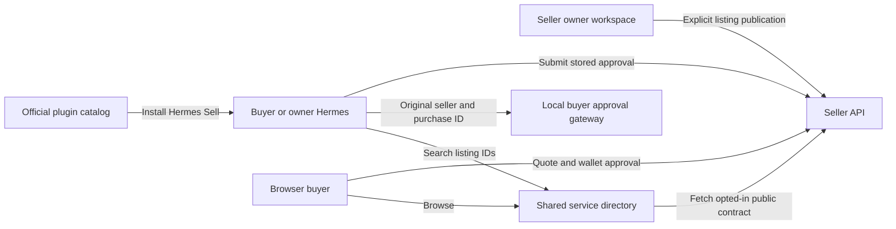
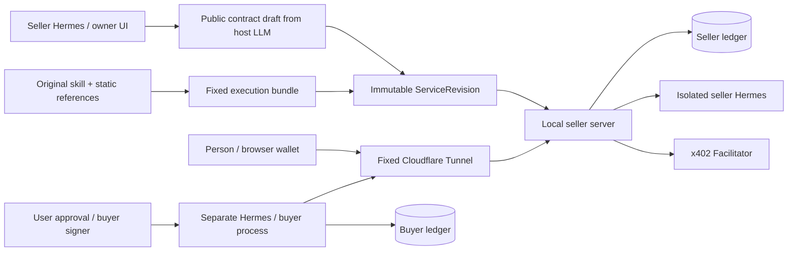

# Fixed Architecture

Create a service from a skill, let a person buy it through a browser, and let a separate Hermes buy the same contract and use the result. All three outcomes are required. This document defines the target architecture; [status.md](status.md) tracks the current implementation separately.

All three flows now work locally on Base Sepolia. External hosting is deferred at the user's request; the Tunnel below remains a future deployment step.

The service directory is a separate layer from the official Hermes plugin
catalog. The official catalog distributes the Hermes Sell package. Our directory
indexes owner-published API contracts across sellers, and executes no user tasks.

Directory identity is a digest of the exact seller origin and service slug.
Published revisions remain immutable; a new service revision requires another
explicit directory publication. Registration fetches only the seller's scoped
public publication endpoint. Public metadata contains no execution bundle.
Listings indicate online, offline, stale or withdrawn state. The current local
directory fetches only operator-configured loopback seller origins, with no
redirects or ambient proxies. Open Internet registration is not enabled.

The buyer's one SQLite ledger stores purchases from multiple origins. Sessions
and challenges remain scoped per seller. Approval contexts resolve by listing
ID or persisted purchase ID; agents cannot override a saved purchase origin.
Budget reservations include all sellers and unknown outcomes. The browser's
payment nonce and exact quote checks remain unchanged.

## Business Flow

The seller selects the original skill and examples → AI proposes a public contract → the seller edits it and sets a price → the same execution adapter runs a test → the seller reviews the results and publishes → a person or Hermes reviews and approves a quote → the result is saved → settlement is confirmed → the result and receipt are delivered.

## Implementation Boundaries

- Seller server: Python + FastAPI. Exposes only public pages, service contracts, orders, and status queries.
- Owner management: a separate loopback entry point for skill file access, drafts, owner execution tests, and publication. Owner tests do not charge USDC but use the configured model account.
- Buyer: a separate process and database. The seller process has no authority to sign for the buyer.
- Runtime: a Hermes environment that does not share the personal home directory, memory, browser, or wallet. Changing a profile name alone does not provide isolation.
- Web: a static React + TypeScript build. Node is needed only during the build.
- Seller ledger: local SQLite with WAL, `synchronous=FULL`, short transactions, and a single seller server.
- External access: a named Cloudflare Tunnel with a fixed HTTPS origin. Orders and status queries stop when the computer is off.

## Contracts and Execution

`ServiceRevision` separates public fields from the private execution bundle. Public fields are explicitly selected for serialization. Hashes bind the original `SKILL.md`, selected static references, wrapper, tool policy, model routing, and input/output schemas.

The initial scope is text/JSON and static references. Skills that require external writes, browser login, arbitrary installation, or intermediate questions to the user are unsupported. The runtime must enforce tool restrictions; prompts alone do not guarantee them.

## Order Rules

1. Keep SIWX wallet authentication separate from payment authorization.
2. Bind each quote to the origin, revision, input, price, recipient address, network, asset, and expiry.
3. Return the same order for the same request key. Reject reuse of that key with a different input.
4. Allow one authorization per order. Reuse the same payload and nonce for network retries.
5. Persist execution intent, then submit to the Hermes Runs API with a fixed Idempotency-Key.
6. Check successful completion, the execution deadline, and the output schema. Save the result in the ledger first.
7. Persist settlement intent, then settle through the official x402 SDK. Do not let generic middleware settle a `202` response.
8. Release the result only when it is ready and settlement is confirmed.
9. Treat a lost execution submission or settlement response as `unknown`. Do not bypass it with a new execution or signature.

The first real payment scope is Base Sepolia USDC / x402 v2 / exact EIP-3009 / EOA. Verification does not reserve funds, so an execution can finish without the seller receiving payment.

## Recovery

A normal restart reads the ledger. Executions being submitted and settlements in progress remain unknown. Queries for a known run ID may be repeated. Do not automatically repeat side effects while an outcome is unknown.

Restoring a backup differs from a normal restart. Start in `recovery_required` to block new side effects, then reconcile against remote Runs and chain records. If the ledger is lost, duplicate prevention and result recovery cannot be guaranteed.

## Sources

- [Hermes plugins](https://hermes-agent.nousresearch.com/docs/developer-guide/plugins)
- [Hermes v0.22.7 Runs implementation](https://github.com/NousResearch/hermes-agent/blob/v0.22.7/gateway/platforms/api_server_runs.py)
- [Hermes Plugin LLM](https://github.com/NousResearch/hermes-agent/blob/v0.22.7/website/docs/developer-guide/plugin-llm-access.md)
- [x402 SIWX](https://docs.x402.org/extensions/sign-in-with-x)
- [Python x402 2.27.0](https://pypi.org/project/x402/2.27.0/)
- [Cloudflare Tunnel](https://developers.cloudflare.com/tunnel/get-started/)
