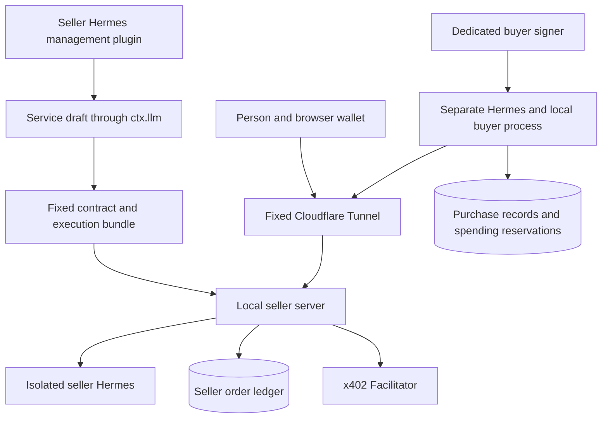

# Final Design Review

**Keep all three required outcomes, address five implementation conditions, then freeze the architecture.** The required outcomes are service creation from an existing skill, real purchases through a public web page, and real purchases with result use by a separate Hermes. Retain the combination of a local machine, Cloudflare Tunnel, a Python server, SQLite, and the Hermes Runs API.

This final review is based on the [reviewed architecture](architecture.md). Official sources and the published Python x402 2.27.0 wheel were checked on November 6, 2026. The findings below identify design conditions that needed clarification. They are not bug reports against an implementation that did not yet exist. See [status.md](status.md) for current implementation progress.

## Final Decision

| Category | Decision |
| --- | --- |
| Keep | All three required outcomes, fixed service revisions, local execution, and a fixed Tunnel address |
| Keep | Python server, static React web app, a single SQLite writer, and settlement after saving results |
| Change | Exclude a combined seller and buyer process from the first version |
| Clarify | Separate order retries from new payment signatures and define authorization validity periods |
| Clarify | Separate the original skill execution bundle from public service descriptions and schemas |
| Clarify | Fix the supported wallets and buyer clients, and add installation and restoration acceptance criteria |

Adopting this architecture does not establish readiness for real sales. Sales readiness requires the integration checks below to pass.

## Five Required Improvements

### Separate the Public Server from the Buyer Signer

The earlier document allowed one service server to act as both seller and buyer. Giving a process that receives public HTTP requests the authority to sign for a buyer wallet would blur the access boundary.

Use the same repository and plugin package, but separate the seller and buyer processes. The seller process manages public pages, orders, settlement, and the recipient address. The buyer process exposes only a local management entry point and manages user approval, spending limits, the signer, and purchase records. Never send the buyer's private key to the seller.

Use a separate Hermes instance and wallet for the first demonstration. If both roles must run on one machine, separate their OS users or containers and credential access as well as their processes. The seller Hermes runtime must also be unable to read the personal home directory, browser data, or buyer secrets.

### Define Separate Rules for Payment Retries and Expiry

The official EVM clients create a new nonce when generating a payment payload. The Python implementation uses 3600 seconds when `max_timeout_seconds` is absent or zero. The TypeScript implementation uses `maxTimeoutSeconds` directly. Do not depend on defaults or generic automatic retries. [Python client](https://github.com/x402-foundation/x402/blob/2ef9f3872fbc0cfc93b1143f26ed668d13a7725e/python/x402/mechanisms/evm/exact/client.py), [TypeScript client](https://github.com/x402-foundation/x402/blob/2ef9f3872fbc0cfc93b1143f26ed668d13a7725e/typescript/packages/mechanisms/evm/src/exact/client/eip3009.ts)

The rule is one authorization and one execution per order. Transmission retries use the same order and existing payload. If admission is uncertain, query the original order. Do not let generic x402 payment retries generate a new signature. If a browser refresh loses the payload held in memory, authenticate and query the order to recover. Do not automatically sign again.

The initial timing proposal is a 5-minute quote, a 180-second payment authorization, at least 120 seconds of authorization validity remaining at admission, and a 60-second execution limit. Leave time to confirm execution has stopped and to settle. These are policy values to adjust after implementation, not performance guarantees. Store the HTTP wait timeout, quote expiry, execution limit, and payment authorization expiry in separate fields.

A timeout or closed connection alone does not prove that payment failed. If settlement was attempted, keep the outcome `unknown` and inspect chain transactions and authorization usage. Do not start a new settlement after authorization expiry or bypass the uncertainty with a new authorization or another order. A verified signature does not reserve funds, so the seller may still fail to recover the execution cost.

### Separate the Execution Bundle from the Public Contract

The generator produces a draft public description, input/output schemas, and examples. Execution uses a bundle containing the seller-selected original `SKILL.md`, allowed static references, a fixed wrapper that inserts the input, model routing, and tool policy. Do not execute a model-rewritten description in place of the original skill.

Freeze the execution bundle as a read-only snapshot with a hash. The public revision references this bundle and the test report. The public page, quote, order, and execution use the same revision. Record the actual model, provider, and execution result, without claiming that model responses are fully reproducible.

The initial scope is skills that use text/JSON input and static references. Explain why skills requiring arbitrary script installation, browser login, intermediate questions, or external writes are unsupported. Define successful execution as normal completion within the execution limit with output that passes the schema. Do not convert interruptions, exhausted budgets, pending approvals, or errors into successful completion and charge for them. Schema validation is separate from checking the accuracy of the result's content.

### Fix the Buyer Client and Wallet Scope

The required clients are a browser wallet client on the public website and a Python buyer client in a separate Hermes. The initial scope is Base Sepolia USDC, the exact scheme with EIP-3009, and EOA wallets. Reuse existing SDKs for wallet connections. The buyer Hermes test wallet uses a protected local credential store and a separate signer.

The plugin directly provides the `service_inspect` → `service_quote` → `service_purchase` → `service_status` flow. Bind purchase authorization to a record created by a user action. Fix the origin, order_digest, recipient address, network, asset, amount, and expiry in that record. Check the web and Python clients against the same protocol fixtures.

SIWX authenticates the wallet; payment authorization is separate. An issued query session must not grant spending authority. When a session expires, authenticate again and query the original order. Do not assume that a generic x402 client or Pay CLI supports this entire asynchronous order flow. [SIWX](https://docs.x402.org/extensions/sign-in-with-x), [Pay CLI](https://github.com/solana-foundation/pay/blob/d76d57ddbce5f2338432d98cfc06240992d49097/agent-plugins/pay-cli/README.md)

### Include Installation and Restoration in the Acceptance Criteria

Distinguish a running process from a service ready to sell. Accept new orders only when the fixed HTTPS address, Hermes connection, snapshot, execution policy, database writes, and facilitator support are ready. When the machine is offline, status queries and new orders stop. The Tunnel does not store them on the machine's behalf.

Use an independent seller Hermes environment for execution. Do not share the personal home directory, browser sessions, or personal memory. A different profile name alone does not establish isolation. The public API must not expose management, generation, free testing, or wallet signing routes.

After a server restart, recover from the saved order state. Restoring a backup is a separate case because it rolls the ledger back, so start in `recovery_required`. Do not automatically resume new executions or settlements before reconciling remote executions and chain transactions. Do not claim guaranteed results or duplicate prevention for orders whose missing records cannot be recovered.

Verify installation, configuration, startup, shutdown, updates, and restoration on a new machine or clean environment. A demonstration that depends on the developer's existing paths or environment does not establish a complete installation process.

## Fixed Runtime Structure

Keep public pages, contracts, orders, and payment modules within one seller server. Do not create a separate server for every module. The buyer process is a local client that calls other sellers and is not publicly exposed. Owner tests and paid executions use the same execution adapter, but unpaid tests can only be created through the management entry point.

## Checks Before and After Implementation

| Check | Acceptance criterion |
| --- | --- |
| Real skill authoring | Generate contract drafts from two different skills and execute the exact selected snapshots |
| Human purchase | Receive a real result after a testnet payment from a separate browser wallet |
| Hermes purchase | A separate Hermes makes a real purchase after user approval and uses the result in a follow-up answer |
| Duplicate requests | Concurrent requests and lost responses do not duplicate execution or settlement for the same order |
| Payment deadlines | Reject insufficient signature validity before execution; switch to queries when the settlement response is uncertain |
| Restart | Recover the original state after termination immediately following execution submission, result storage, settlement transmission, or settlement success |
| Permissions and revisions | Block access to another wallet's orders, management routes, and personal files; preserve the order revision |
| Installation and backup | Run in a clean environment and verify restored state without automatically repeating side effects |

The first development unit is **the smallest flow in which a person and Hermes each make a real purchase of one fixed contract**. Once this path works, connect the skill generator and publication handler. Then strengthen restart, duplicate-request, and expiry checks and complete the UI. This sequence retains all three required outcomes while resolving the largest integration uncertainties first.

## Evidence and Verification Scope

The SHA-256 of the published [Python x402 2.27.0](https://pypi.org/project/x402/2.27.0/) wheel was checked against PyPI metadata. The AST and source were inspected without importing the code or sending payment requests. This confirmed the presence of `verify_payment`, `settle_payment`, SIWX requests, and client hooks. The `settle_payment` after-handler phase, nonce generation, and validity handling were also checked.

The [Hermes v0.22.7 Runs implementation](https://github.com/NousResearch/hermes-agent/blob/v0.22.7/gateway/platforms/api_server_runs.py) and [Plugin LLM Access](https://github.com/NousResearch/hermes-agent/blob/v0.22.7/website/docs/developer-guide/plugin-llm-access.md) were cross-checked. Execution idempotency and profile/credential scope do not replace the application's own order ledger. Confirming that a published SDK contains the required functions does not establish that browser wallets, real settlement, and Hermes profile connections have passed integration testing.

This review covered architecture and source inspection only. Plugin implementation, real model calls, testnet transactions, and a public Tunnel connection were not performed as part of this review. Current implementation progress is recorded separately in [status.md](status.md).
