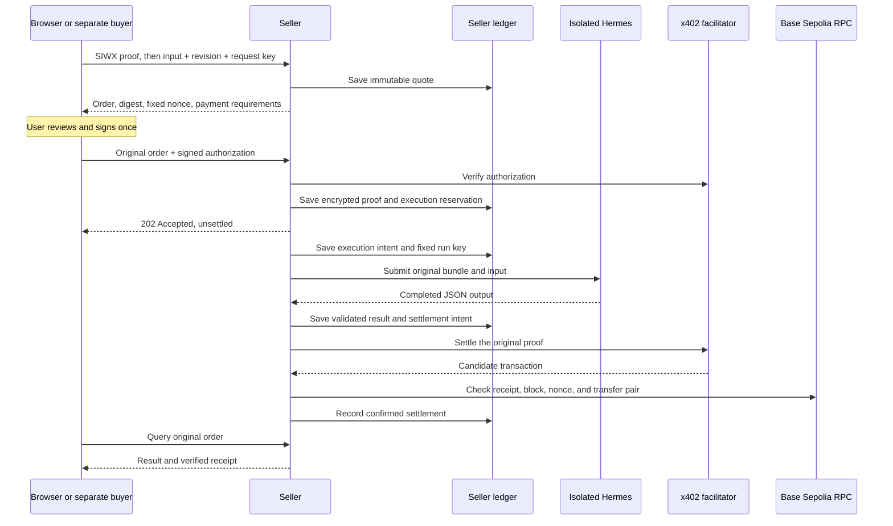

# Order protocol 0.1

Hermes Sell supports a default local simulation and a separate Base Sepolia implementation. This asynchronous order API is an application protocol around x402 v2. A standard x402 fetch wrapper does not automatically implement its quote, approval, execution, and recovery steps.

## Public seller API

| Route | Purpose |
| --- | --- |
| `GET /ui-config` | Surface role, payment mode, configured origin, network, asset, and execution mode |
| `GET /health/ready` | Current adapter and worker readiness; not evidence of a completed purchase |
| `GET /v1/services` | List published service contracts |
| `GET /v1/services/{slug}` | Read the current immutable public contract |
| `GET /v1/services/{slug}/openapi.json` | Read the input schema and order API specification |
| `POST /dev/session` | Designated development accounts, simulation only |
| `POST /auth/challenge` | Testnet SIWX challenge bound to the requested EOA address |
| `POST /auth/verify` | Verify the unchanged challenge plus EIP-191 signature and issue a session |
| `POST /v1/services/{slug}/orders` | Bearer session + Idempotency-Key + revision/input → immutable quote |
| `POST /v1/orders/{id}` | Submit the same owner's approval payload → `202 Accepted`, still unsettled |
| `GET /v1/orders/{id}` | Owner-only status; result appears only after confirmed settlement |

SIWX proves wallet ownership. It does not authorize payment. Challenge fields include the configured seller domain, fixed `/auth/verify` URI, EOA address, Base Sepolia chain ID, nonce, statement, and expiry. The server consumes the challenge once and requires the signed fields to remain unchanged. It derives the domain from configuration, not forwarding headers.

This application transports the official SIWX payload in the `/auth/verify` JSON body. It uses the SIWX/EIP-4361 message format and official verification boundary; it does not use automatic payment middleware to grant sessions or settle `202` responses.

## Quote and signature binding

A quote fixes its ID, owner, seller origin, service revision, input, price, recipient, network, asset, and expiry. The revision also commits to the original execution bundle and schemas. The same request key returns the same quote; reusing that key with a different input or revision is rejected.

For testnet orders, `payment_nonce` is `0x` followed by `order_digest`, the SHA-256 digest of the initial canonical order document. That nonce enters the signed EIP-3009 `TransferWithAuthorization` message. This binds the payment to the order instead of relying on unsigned x402 resource metadata alone.

The browser validates and displays the amount, payee, seller origin, network, and digest before an explicit approval. It uses the official x402 authorization types and viem signing to supply the fixed nonce; the SDK's convenience signer normally generates a random nonce. The payment payload retains the official v2 shape: `x402Version`, `accepted`, `resource`, and `payload`. The resource URL is the exact seller order URL.

Supported scope:

| Field | Value |
| --- | --- |
| Network | Base Sepolia, `eip155:84532` |
| Asset | USDC, `0x036CbD53842c5426634e7929541eC2318f3dCF7e` |
| Payment | x402 v2 `exact`, EIP-3009, EOA |
| EIP-712 domain | `USDC`, version `2`, chain ID `84532` |
| Default quote lifetime | 300 seconds |
| Browser authorization lifetime | 180 seconds, with at least 120 seconds remaining at admission |
| Execution limit | 60 seconds |
| Concurrent admitted orders | One |

Mainnet and smart-account signing are disabled in this release. A verification success is not a reservation of funds.

## State and chain evidence

Execution follows `created → queued → dispatching → running → result_ready`. Payment follows `required → verified → settling → settled`. Either can enter `failed` or `unknown`. Even at `result_ready`, the result remains withheld until payment reaches `settled`.

A facilitator success is only a candidate transaction. The chain reader requires a successful receipt, its matching canonical block hash, and the configured confirmation depth. In the full receipt, the expected USDC `AuthorizationUsed(payer, nonce)` must appear immediately before the matching `Transfer(payer, recipient, amount)`. Independent matches elsewhere in a batched receipt cannot credit two authorizations for one transfer.

The default depth is two Base Sepolia L2 blocks, counting the inclusion block. This is a testnet soft confirmation, not Ethereum L1 finality. The receipt reports its block hash, block number, depth, and confirmation policy.

Reconciliation checks a saved transaction candidate and bounded nonce-related logs. It can confirm settlement, confirm cancellation, or establish an expired unused authorization at a sufficiently old chain block. Incomplete scans, missing evidence, RPC errors, and ambiguous outcomes remain `unknown`.

## Recovery and storage

The seller persists execution and settlement intent before external side effects. It encrypts testnet payment payloads with the local vault key. Retries use the identical payload and nonce. A lost runtime submission or settlement response never creates a new run or payment signature.

The storefront keeps its session token and signed payment payload in memory. Browser storage retains the original order ID. Reload requires wallet reauthentication and an original-order lookup; it does not re-sign automatically. After an attempted signature, a replacement for an unadmitted order requires a fresh lookup started after the previous authorization's possible expiry. Wallet account or chain changes invalidate the browser session.

The separate buyer stores its seller session and authorization encrypted in its own ledger. Its browser page stores only signature-attempt metadata for recovery. An uncertain approval retry resends the original in-memory payload; a reload with no payload does not generate a new signature.

Normal restart uses the same ledgers and runtime state. Old backup restoration requires the recovery lock and reconciliation. An execution timeout does not prove the run stopped; unresolved execution stays unknown.

Unknown executions use read-only polling. A lost run ID can be recovered from the pinned container's retained admission ledger only when the credential scope, run key, and complete request fingerprint match. Recovery never repeats run submission. A late result cannot start a new settlement; a result for an already confirmed payment can be restored after the deadline.

A locked backup returns `recovery_required: true`. Unconfirmed snapshot states appear as `unknown`, including an old quote that still says payment was required internally. Buyers must keep their reserved budget until evidence resolves the outcome. Local order reads and authenticated owner recovery remain available during dependency outages; new execution and settlement remain blocked.

`POST /admin/orders/{order_id}/reconcile` checks execution and payment without repeating either side effect. Its optional body is `{"transaction":"0x…"}` with a complete 32-byte transaction hash. A hash is only a hint: exact order-bound USDC receipt evidence and the confirmation policy must pass before payment is recorded. This supports older payments beyond the bounded 5,000-block automatic scan. Missing evidence never means unpaid, and recovery does not unlock a restored ledger automatically.

## Separate owner and buyer surfaces

Owner routes require the private owner token on a different loopback port:

| Route | Purpose |
| --- | --- |
| `POST /admin/drafts` | Save a manually edited skill and contract as a new revision |
| `POST /admin/drafts/import` | Import a private Hermes draft by ID, slug, amount, and payee |
| `GET /admin/revisions/{revision}` | Read the original private bundle for owner review |
| `POST /admin/revisions/{revision}/test` | Run the configured execution adapter and validate output |
| `POST /admin/revisions/{revision}/publish` | Publish after a successful test and explicit owner review |
| `GET /admin/orders` | Read seller order states |
| `POST /admin/orders/{id}/reconcile` | Reconcile execution/payment; optionally verify a transaction-hash hint |

The private `DraftStore` contains the original bundle and validated public draft under a content digest. It is shared deliberately between the owner plugin and management application; it is not served by public routes.

The separate loopback buyer gateway provides `/connect` and `/approve/{purchase_id}`. Its `/buyer/auth/challenge` and `/buyer/auth/verify` routes forward seller-bound authentication, and `/buyer/session` returns safe metadata without a bearer token. `GET /buyer/purchases/{id}` reads the saved purchase. `POST /buyer/purchases/{id}/approve` accepts the exact digest and browser-signed authorization. There is no gateway submit endpoint: after approval, the CLI or Hermes tool submits that existing purchase.

## Shared directory and seller selection

| Surface | Endpoint | Purpose |
| --- | --- | --- |
| Seller public | `GET /.well-known/hermes-sell/listings/{slug}` | Public contract only after owner opt-in, scoped to one directory |
| Owner | `GET /admin/listings` | Read directory publication state |
| Owner | `POST /admin/listings/{revision}` | Opt in a reviewed published revision and register its origin/slug |
| Owner | `POST /admin/listings/{revision}/withdraw` | Withdraw discovery publication |
| Directory | `GET /v1/listings?q=&mode=` | Bounded search summaries across sellers |
| Directory | `GET /v1/listings/{listing_id}` | Full validated public contract and availability |
| Directory | `POST /v1/listings` | Refresh a seller-owned publication using `{origin,slug}` |
| Buyer | `GET /buyer/purchases` | Safe history across seller origins |
| Buyer | `GET /buyer/purchases/{id}/status` | Refresh the original purchase without submitting it |

The local directory permits only configured loopback seller origins. A client
cannot inject another seller's description, execution bundle or arbitrary URL.
Listing identity binds origin and slug. Search summaries omit large schemas and
examples; detail reads return the complete public contract. Registration and
refresh use version guards so a stale response cannot replace newer metadata.

The wallet gateway selects an existing purchase using `X-Purchase-ID`, or a
directory listing using `X-Listing-ID`. Conflicting contexts fail. The same
context is sent during UI configuration and wallet requests. A saved purchase's
origin comes from the private ledger, never a request-supplied replacement URL.
Session encryption remains origin-scoped; approvals reserve one shared budget
across all sellers. History never returns encrypted authorizations or sessions.

## Seller onboarding, analytics and reviews

| Surface | Endpoint | Purpose |
| --- | --- | --- |
| Directory | `GET /v1/sellers` | Configured local seller origins for registration |
| Directory | `POST /v1/sellers/check` | Check only an allowed exact origin using `{origin}` |
| Owner | `GET /admin/seller` | Seller readiness and publication counts |
| Owner | `GET /admin/analytics?period=7d\|30d\|all` | Private usage and confirmed-payment aggregates |
| Buyer | `GET /buyer/analytics` | All-time local spending and shared budget across sellers |
| Seller public | `GET /.well-known/hermes-sell/review-key` | Application Ed25519 purchase-attestation public key |
| Seller authenticated | `POST /v1/orders/{id}/review-challenge` | Prepare `{score,comment}` for an owned, completed, settled order |
| Seller authenticated | `POST /v1/orders/{id}/review` | Forward `{challenge_id,signature}` for that original order |
| Buyer | `POST /buyer/purchases/{id}/review-challenge` | Prepare through the persisted seller and wallet session |
| Buyer | `POST /buyer/purchases/{id}/review` | Publish the same review signature; no payment approval |
| Directory | `GET /v1/listings/{id}/reviews` | Rating summary and latest 50 public reviews |
| Directory | `POST /v1/listings/{id}/review-challenges` | Validate compact seller-signed `{proof,score,comment}` |
| Directory | `POST /v1/listings/{id}/reviews` | Verify the challenge, buyer signature and exact chain receipt |

Owner listing publication accepts optional `{"share_usage":true}`. The default
is false. Only aggregate counts and gross settled volume are added to the
public manifest. Public aggregates are labeled seller-reported; private
analytics and buyer sessions stay on their original local surfaces. Numeric
amounts are decimal strings in USDC base units, including large totals.

Seller proofs contain only version, mode, origin, slug, listing/order/revision
IDs, payer, amount, payee, network, asset, payment nonce, transaction and issue
time. The directory fetches the issuer key only from an allowed exact seller.
Challenges expire after five minutes. Testnet publication requires an EIP-191
review-only signature from the payer and independent `ChainReader.confirm`
evidence. Simulation uses no wallet signature and has a separate mode label.

The directory stores one review per listing and buyer. A receipt nonce cannot
support reviews for different listings. Challenge sequence numbers stop an old
unsubmitted review from overwriting a newer review. Only a signature hash is
retained for retry matching. Identical retries return the current review set;
they never create a second vote or invoke execution/payment. Purchase inputs,
outputs, provider credentials and bearer tokens are not sent to the directory.

## Sources

- [Official x402 SIWX](https://docs.x402.org/extensions/sign-in-with-x)
- [x402 buyer integration](https://docs.x402.org/getting-started/quickstart-for-buyers)
- [Hermes v0.22.7 Runs implementation](https://github.com/NousResearch/hermes-agent/blob/v0.22.7/gateway/platforms/api_server_runs.py)
